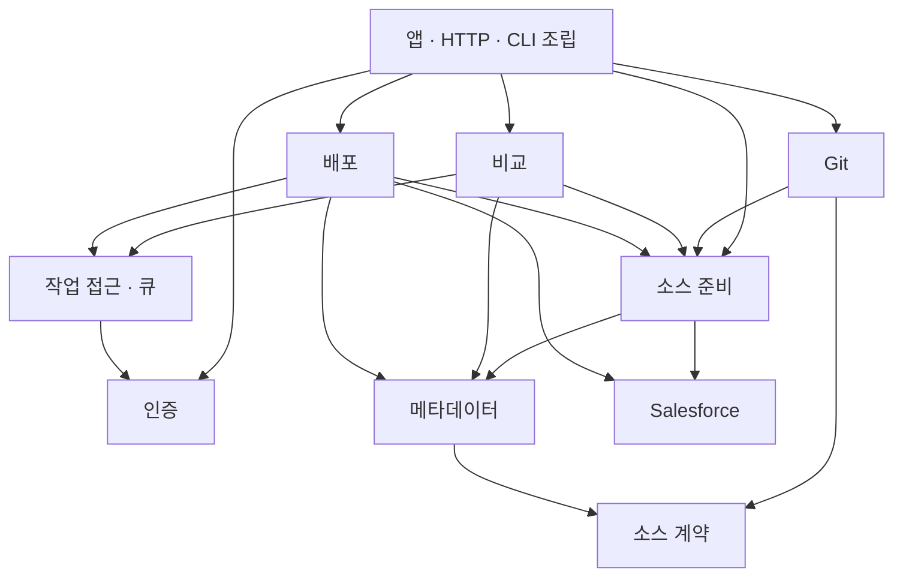

# 모듈 경계와 리팩토링 기록

상태: `IMPLEMENTED_LOCAL`. 하나의 Node.js 애플리케이션과 SQLite DB를 유지하며 인증 라이브러리는 추가하지 않았다. 원격 CI·배포 상태는 이 문서의 로컬 검증과 별도로 확인한다.

## 소유권

| 위치 | 책임 | 외부 진입점 |
| --- | --- | --- |
| `src/auth` | 사용자·역할, 비밀번호, 세션 정책·저장, 트랜잭션 내 사용자 상태 조회 | `public.ts`, 앱 전용 `composition.ts` |
| `src/sources` | 소스 준비 계약, 관리 프로젝트 용량·소유권·파일 수명, 불변 스냅샷 | `model.ts`, `ports.ts`, `public.ts`, 앱 전용 `composition.ts` |
| `src/git` | 연결·토큰·저장소·브랜치·가져오기·등록·캐시, Git 저장소 구현 | 앱 전용 `composition.ts`, 주입된 `SourceProvider` |
| `src/salesforce` | 연결·인증정보·Org 식별·Salesforce 프로세스 실행 | `public.ts`, 앱 전용 `composition.ts` |
| `src/metadata` | 컴포넌트 해석·선택, manifest, XML 비교·패키지 처리 | `public.ts`, 앱 전용 `composition.ts` |
| `src/compare` | 비교 실행·작업 이력 | 앱 전용 `composition.ts` |
| `src/deploy` | 검증·배포·Quick Deploy, 상태·실행 시도·복구·실행 권한 | 앱 전용 `composition.ts` |
| `src/jobs` | 작업 접근 권한 및 공통 실행 큐 | `public.ts`, 앱 전용 `composition.ts` |
| `src/settings` | 사용자 설정 저장 및 조회 | 읽기용 `public.ts`, 앱 전용 `composition.ts` |
| `src/reports` | 비교 보고서 렌더링·파일 생성 | `public.ts` |
| `src/contracts` | 브라우저와 HTTP 사이의 스키마·직렬화 자료형·순수 표시 함수 | 각 계약 파일 |
| `src/core`, `src/storage` | 파일·오류·암호화 등 작은 기반 기능, DB 실행·트랜잭션·아티팩트 저장 | 각 기반 파일 |
| `src/app`, `src/web`, `src/program.ts`, `src/cli.ts` | 모듈 조립·마이그레이션·실행 환경, HTTP·CLI 어댑터 | 앱 진입점 |

`composition.ts`는 앱에서 서비스·저장소를 생성하고 연결하기 위한 명시적인 진입점이다. 업무 모듈은 다른 모듈의 `composition.ts`를 사용할 수 없다. 모듈 내부 클래스가 필요하면 소비자에게 필요한 메서드만 갖는 공개 계약을 제공한다.

`SourceDescriptor`와 소스 실행 모델은 HTTP 스키마와 독립적이다. `sources/model.ts`와 `sources/ports.ts`는 소스 구현보다 낮은 계약 계층으로 검사한다. 메타데이터 모듈이 소스 계약을 사용하는 것은 허용하지만 소스 실행 구현을 가져오는 것은 금지한다.

## 의존 방향



Git은 `SourceProvider`를 구현하며 앱이 소스 서비스 생성 시 주입한다. 소스·비교·배포에는 Git 서비스 참조를 나중에 대입하지 않는다. 비교 서비스는 준비 결과의 ID와 lease만 사용한다.

## 인증과 권한

- 기존 scrypt 해싱, 12시간 DB 세션, 토큰 해시 저장, LOCAL 모드 동작을 유지한다.
- `auth/session-repository.ts`가 세션 조회·저장·폐기를 담당한다. 세션 정책과 로컬 비밀번호 결합 검증은 `AuthService`가 담당한다.
- `web/server/auth-http.ts`는 쿠키, Origin·CSRF 검사, 요청 사용자 연결을 담당한다. 인증 모듈은 Fastify를 참조하지 않는다.
- 배포와 작업 접근 모듈은 인증 모듈의 사용자 상태 조회를 사용한다. 쓰기 권한을 확인할 때 호출자의 DB 트랜잭션을 전달해 확인과 저장 사이의 일관성을 유지한다.
- Git 토큰과 Salesforce 인증정보는 각 모듈이 소유한다. 공통 암호화 primitive는 `core/token-vault.ts`에 있으며 기존 암호문·AAD 형식을 유지한다.
- DB 마이그레이션과 시작 시 모드·암호화 키 초기화는 앱의 조립 책임이다. 기존 DB 버전과 테이블 이름을 변경하지 않는다.

## 소스 수명

`PreparedSource.release()`는 준비 단계의 사용권을 해제한다. `discard()`는 실패한 준비에서 새로 만든 자원만 정리한다. 기존 소스 참조의 discard는 원래 소스를 삭제하지 않는다.

등록 브랜치를 준비하면 커밋이 고정된 파일을 만들고 즉시 pin한다. 비교 작업이 자신의 pin을 획득한 뒤 준비 단계의 pin을 해제한다. 실행·대기 중 파일은 삭제할 수 없으며 종료 시 작업의 pin을 해제한다. 준비 직후 pin 획득이 실패한 경우 생성된 import도 정리한다.

작업 이력에는 불변 공개 출처 정보만 복사한다. 물리 경로나 인증정보는 그 정보에 포함하지 않는다.

## 실행과 UI

- `compare/execute-comparison.ts`, `deploy/execute-deployment.ts`가 실행 로직을 소유한다.
- `app/cli-operations.ts`가 터미널·JSON 출력과 CLI 종료 코드를 처리한다. HTTP 서비스는 출력 콜백을 끄는 대신 실행 함수를 직접 호출한다.
- `DeploymentStateMachine`이 전이 허용과 시간값을 판단한다. 저장소는 트랜잭션·동시성 검사를, 서비스·조정자는 제출·조회·복구 순서를 담당한다. 기존 상태 개수와 의미를 유지한다.
- 직접 배포는 사전 Dry-run 없이 제출한다. 명시적 검증 후 승인 경로는 기존 Quick Deploy 적격성 판단을 유지한다.
- `ui/src/workflows`는 Git 소스 선택·비교·배포·작업 복원을 연결한다. `ui/src/git/GitBranchSource.tsx`가 Git 준비를 소유하고, `ui/src/deployment`는 배포 설정·확인·진행 표시를 소유한다.
- UI 모듈 간 접근은 `public.ts` 또는 `api.ts`로 제한한다. 브라우저에서 서버 구현을 직접 가져오는 것을 금지한다.

## 자동 검증

```sh
npm run architecture:check
npm run typecheck
npm run quality
npm test
npm run build
npm run test:e2e
npm run package:smoke -- --use-existing-build
```

`quality`에 경계 검사가 포함되어 기존 CI의 `npm run check`에서 실행된다. 검사에는 임시 예외 목록이 없다. 정적 import·re-export·동적 import·타입 import를 분석해 금지 의존, 내부 직접 참조, 해석되지 않는 경로, 모듈 순환을 차단한다. 모듈 추가 시 허용 방향을 명시해야 한다.

단위 테스트는 구현 내부에 직접 접근할 수 있다. 프로덕션 import 규칙을 느슨하게 만들어 테스트를 통과시키지 않는다.

추가 회귀 검증은 비-Git provider 주입, 출처 정보 불변성, 소스 소유권, 준비 단계에서 작업 단계로의 pin 인계, pin 실패 시 import 정리를 다룬다. 인증·배포·Git·CLI 기존 회귀 테스트와 데스크톱·모바일 E2E를 함께 유지한다.

## 2026-10-22 로컬 검증 기록

| 검사 | 결과 |
| --- | --- |
| 최종 `npm run check` | 통과: typecheck, quality, 전체 테스트, CLI·UI 빌드 |
| 전체 Vitest | 105개 파일, 755개 통과·3개 건너뜀 |
| 모듈 경계 검사 | 프로덕션·UI 232개 파일, 임시 예외 없음 |
| 경계 검사 자체 회귀 테스트 | 6개 통과 |
| 전체 Playwright | 121개 통과, 데스크톱·모바일 포함 |
| CLI 출력 최종 분리 후 Playwright | 인증·직접 배포·검증·반응형 등 핵심 8개 재검증 통과 |
| 최종 빌드의 설치 패키지 smoke | 초기 설정, UI, 종료, SQLite, 다른 CWD에서 재시작 통과 |
| 잠금 파일 동기화·`git diff --check` | 통과 |

전체 E2E 이후 CLI 출력 어댑터 분리를 마무리했으며, 그 최종 코드에 전체 단위 테스트·빌드·핵심 E2E·패키지 smoke를 다시 적용했다. Salesforce 테스트는 fixture 기반이며 실제 Org 배포를 실행한 기록은 아니다. 커밋·push·PR·원격 CI 검증은 수행하지 않았다.
